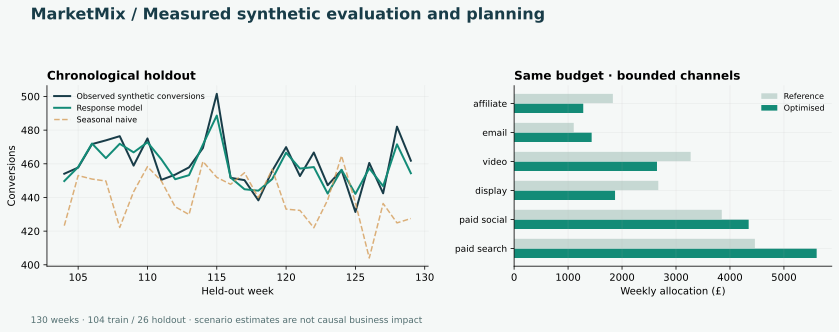

# MarketMix Decision Engine

**From weekly marketing data to an evaluated response model and a constrained allocation.**

An AI-assisted portfolio implementation by **Vikas Reddy Konreddy**, connecting
commercial analytics experience with applied modelling and software development.
All data and scenario outputs are **synthetic**. This repository contains no
Axtria or client data, code, model parameters or business results.



## The problem

A planning team needs to understand how channel spend relates to conversions,
compare model performance against a baseline, and explore a budget allocation
without losing control of total spend or individual channel limits.

This small application makes those assumptions and constraints inspectable.
It combines a reproducible data ledger, SQLite reporting, a fitted response
model, a chronological evaluation, a numerical optimiser and a local web UI.

**Python · NumPy · SciPy · SQLite · HTTP API · JavaScript · automated checks**

## Measured example results

The included run uses seed **43121**, **130 weeks**, **six channels** and
**780 week/channel spend records**. The last 26 weeks form a chronological
holdout; fitting receives only the first 104 weeks' outcomes.

| Holdout metric | Response model | Seasonal naive baseline |
|:--|--:|--:|
| MAE, conversions | 5.33 | 21.60 |
| RMSE, conversions | 6.48 | 28.27 |

These are results on generated data with a deliberately specified response
structure. They are not evidence of performance on real campaigns. The
evaluation is conditional on observed holdout spend; it is not a forecast of
unknown future spend.

The default four-week planning scenario predicts **1.60%** more conversions
than the same-budget reference allocation. This is a **modelled scenario
change**, not measured, incremental or causal commercial uplift. Full precision
and per-channel allocations are in [reports/evaluation.json](reports/evaluation.json).

## Run it

Tested with Python 3.12, NumPy 2.3.5 and SciPy 1.17.0.

```bash
python -m venv .venv
source .venv/bin/activate
python -m pip install -r requirements.txt
python -m marketmix demo
python -m marketmix serve
```

Open **http://127.0.0.1:8010**. On Windows activate with
`.venv\Scripts\activate`. The checked-in CSVs are ready to use. Delete the
`data/weekly_*.csv` files and run `demo` to regenerate the seeded example.

The interface lets you adjust the weekly budget and channel movement limit,
recalculate a plan, inspect baseline and allocated spend, and see the same
holdout metrics used in the report.

## What is implemented

- **Data validation:** finite values, non-negative spend, contiguous weeks,
  complete channels and unique week/channel keys.
- **SQL:** a separate spend ledger and outcome table, avoiding duplicated
  outcomes when reporting at channel grain.
- **Modelling:** geometric adstock, logarithmic saturation, trend and annual
  Fourier terms, with regularisation and non-negative media coefficients.
- **Evaluation:** chronological holdout, seasonal naive comparison and an
  explicit test that changing held-out outcomes cannot alter predictions.
- **Decision support:** SLSQP optimisation with an equality budget constraint
  and bounded movement around the scaled reference allocation.
- **Delivery:** command-line report, local JSON API, interactive interface,
  checked-in example outputs and a GitHub Actions test workflow.

## Tests

```bash
python -m unittest discover -s tests -v
```

**14 tests passed locally.** They include 15 allocation scenarios, budget and
bound reconciliation, adstock continuity, invalid values, CSV integrity, SQL
totals, holdout leakage and HTTP endpoint checks. The workflow reruns the
suite on pushes and pull requests.

## API examples

`GET /api/report` returns the default evaluation and plan.

`POST /api/plan`, with `Content-Type: application/json`:

```json
{"budget":16000,"movement":0.2}
```

The development server listens on loopback only. It has no authentication or
production hosting configuration and should not be exposed directly to the internet.

## Explore the code

| Path | Purpose |
|:--|:--|
| [marketmix/data.py](marketmix/data.py) | Seeded generator, CSV validation and SQLite ledger |
| [marketmix/model.py](marketmix/model.py) | Response model and chronological evaluation |
| [marketmix/optimizer.py](marketmix/optimizer.py) | Fixed-budget bounded optimisation |
| [marketmix/server.py](marketmix/server.py) | Local API |
| [web/index.html](web/index.html) | Interactive planning interface |
| [sql/channel_summary.sql](sql/channel_summary.sql) | Executable reporting query |
| [docs/METHODS.md](docs/METHODS.md) | Assumptions, evaluation design and limits |
| [docs/INTERVIEW_GUIDE.md](docs/INTERVIEW_GUIDE.md) | Technical walkthrough and discussion questions |

## Development and scope

This is an AI-assisted portfolio project created in October 2026. Implementation
has been checked using executable numerical, data and API tests. It is distinct
from professional client work and does not claim production deployment.
